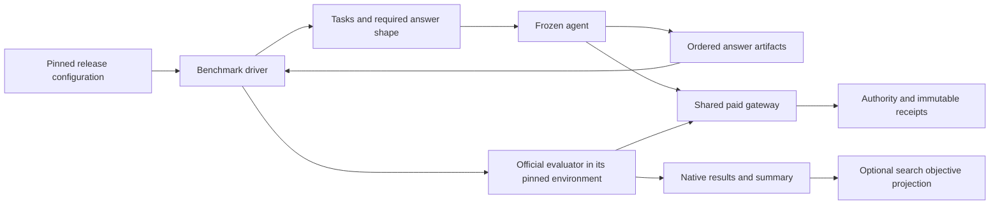

# Replaceable benchmark integration

October 20, 2026. BENCH-03A records the user's confirmed upgrade requirement: **install and pin a new official NoveltyBench release, configure it, check compatibility and funding, then run the existing agent before changing or optimizing that agent.** A benchmark update must not require rebuilding the agent, search controller or accounting system. [PLAN.md](PLAN.md) owns implementation order and status; this document defines the contract and acceptance criteria.

This is an accepted architecture requirement, not a claim that today's code already provides it. BENCH-02's official-conformance gate still applies. No paid route, allocation or historical result changes with this document.

## Three separate boundaries

| Boundary | Owns | Must not depend on |
| --- | --- | --- |
| Agent treatment | Generation instructions/code, model access, sampling/history, selection and inference limits. Consumes tasks and produces ordered answers. | A NoveltyBench release name, judge prompt, metric formula, native artifact directory or judge SDK. |
| Benchmark driver | Task loading, required answer count/shape, official evaluator invocation, its pinned dependencies/configuration, native parsing/retries/fallbacks, artifacts and summary. | Agent policy/source internals or permission to alter spending authority. |
| Shared host and paid gateway | Trusted execution, component verification, generic request/receipt capabilities, credentials, physical-attempt identity, reservation/accounting and replay. | Partition/Score stage names, ten answers, patience 0.8, v1.1 paths or a particular benchmark's score schema. |

The reusable driver/runner invokes the installed pinned official implementation. Compatible releases use the same driver/runner code with different release data and official environments; handwritten adapters per ordinary release do not satisfy this contract. The gateway bridge accounts for actual physical provider attempts without rewriting prompts, adding request parameters, substituting local parsing or dropping official failures. Source-backed differential checks establish that the bridge preserves official behavior. A small allowlisted runner selection is sufficient; no plugin marketplace or new service is required. A necessary capability extension must be explicit and validated before claiming that a previously incompatible interface is supported.

## Release configuration and evidence

One immutable release bundle identifies:

- The benchmark family, release identifier, exact upstream source revision and source inventory. A metric version alone does not identify a changing repository.
- The driver contract/implementation and generic runner entry point, exact dependency lock/environment, and required runtime/platform capabilities.
- Dataset/task schema and hashes, required input/output modality and answer count, official configuration, native artifact inventory and summary entry point.
- Supported paid API capabilities and separately verified model/rate/usage bounds. Release data cannot grant paid authority, choose arbitrary network destinations or declare its own prices trustworthy.
- An optional, explicitly versioned projection from native measurements to the optimizer's objectives. This is separate from producing the official baseline result.

Configuration is data interpreted by reviewed code: declared entry points, argument lists, supported field/path mappings and capability identifiers. It is not arbitrary shell text, Python expressions or downloaded code executed on installation. Resolve mutable aliases such as `latest` once during preparation; a running or resumed experiment always uses its saved immutable selection.

The first NoveltyBench driver covers the existing official text-task/ordered-text-answer interface. Ordinary changes to prompts, datasets, judge models/settings, answer count, artifact names or supported CLI arguments belong in the release bundle. They must not cause edits across agent, search and accounting modules. Native algorithms, prompts, parsing, fallback and summary behavior come from the installed official evaluator, rather than a host copy with a growing set of version branches.

Configuration-only upgrades have a declared compatibility envelope. A future evaluator may introduce images, interactive environments, a new paid endpoint, an incompatible SDK protocol or an entirely different input interface. No implementation can execute unknown interfaces correctly by assumption. Such a change produces a precise compatibility report and an isolated capability/driver extension; it must not spread version checks throughout the host. This exceptional extension is distinct from tuning an agent because its baseline scored poorly.

## First run on a new release

Preparation pins the new evaluator independently of the existing agent. It checks source/lock integrity, supported task/output and provider capabilities, native fixture execution, receipt replay, model availability, verified liability bounds and the concrete allocation. These checks use canned or declared development fixtures; they must not inspect sealed final tasks or optimize against new benchmark scores.

The baseline freezes the existing agent source/policy, generation model and generation settings. Version-driven task requirements, such as the requested number of answers, are explicit task inputs; the agent must already support them through its interface. Changing a prompt template, sampling/history, generation model, limit, selector or instruction is a new treatment, even if someone calls the change compatibility work. Evaluation-side model changes prescribed by the new release belong to the new evaluator identity.

Then run that agent against the new release, retaining all answers, failures, physical receipts and official artifacts. Poor quality, repetition, refusal, malformed task-requested JSON, wrong sentence/count constraints and low scores are baseline outcomes; they are not compatibility failures to filter out. Preflight validates the outer interface, such as whether the agent can return an ordered text list and accept the required count. Unsupported modalities or an unreadable outer artifact are incompatibilities. It must not parse answer content to reject a story or structured task answer before official assessment, silently rewrite it or hide it from the recorded baseline.

The official baseline must be runnable before the search controller understands a changed metric. Save the native results and official summary first. If the new metric has no compatible objective projection, disable optimization and comparative ranking, explain what needs to be mapped, and preserve the baseline. Do not rename an unrelated metric utility/distinctiveness, recompute a convenient replacement score or require an optimization feature before basic evaluation works.

Only subsequent, separately identified treatments may use these development results to improve the agent or its improvement procedure. The official instrument remains fixed within each experiment. Evolvable agent orchestration is allowed; changes to the trusted driver/host bridge require conformance and authority checks and cannot become an unrecorded way to improve scores. Final/held-out results remain outside improvement feedback.

## Retirement without losing history

Retiring a release removes it from active/default selection and prevents new paid run creation. It does not erase results, source bundles, dependency locks, receipts, ledger schemas, unresolved holds or provenance. Keep bounded, read-only historical readers separately from active evaluator execution; preserving evidence does not require importing or installing an old judge SDK.

Existing runs never follow a new default. Before uninstalling their driver, either retain their exact bounded runtime for authorized completion or close their allocations. An unknown operation retains its liability. A replacement call or linked continuation keeps its separate identity. Offline replay of saved receipts is distinct from fresh regeneration, which may become unavailable if an old model is retired.

For new manifests, bind the shared host core, selected driver/source/lock, agent treatment, official configuration, population and paid capability profile separately and together. Include transitive runtime dependencies and nested package files. An unrelated driver installed in its own environment must not change a frozen run's identity; changes to shared code actually used by that run must. Do not solve this by omitting plugin files from source verification.

Legacy manifests retain their existing identity algorithm and sealed runtime. No rehashing, relabeling, blanket source-guard exception or evidence migration is implied. Historical readers must preserve both legal earlier uncertainty receipts and terminal receipts; REC-05A's known limitation remains open.

## Current coupling to remove

These are inspected repository facts, rather than hypothetical future failures:

| Evidence | Consequence for the new boundary |
| --- | --- |
| `run.RunSettings`, `run.evaluate_prompts`, `evaluation.EvaluationProtocol` | Generation and v1.1 judge models/limits/count/formula are combined. Extract the frozen agent/answer-artifact seam; keep v1.1-specific settings with its driver. |
| `reference.py` imports `benchmark.py` and `run._schema` | The request foundation is v1.1-specific. Keep it behind that driver; do not promote it to the shared provider contract. |
| `search.py`, benchmark import/export and CLI/progress | Search assumes v1.1 metrics and artifact paths. Native baseline collection must stand alone; objective projection and promotion/completeness policy remain separate. |
| `authorization.py`, `history.py`, `diagnostics.py`, `policy.py`, `splits.py` imports | Generic JSON/validation or task helpers currently come through scientific modules. Reuse those implementations from a version-neutral boundary as needed; avoid keeping old evaluator code solely to read money records. |
| `authorization.runtime_fingerprint()` | It hashes all top-level package Python files. New manifests need explicit selected-component and dependency inventories; nested drivers must be covered and unrelated installations must not invalidate replay. Preserve the legacy guard. |

The uncommitted BENCH-02B native-call draft was preserved separately before this contract slice. Its stage/model-specific construction must move behind the driver rather than establish a universal host API. No draft paid dispatch is enabled.

## Acceptance criteria

| ID | Required evidence |
| --- | --- |
| MOD-1 | The same frozen agent runs against current and second canned release configurations with different answer counts, dataset fields and artifact paths. Agent, generic driver/runner, controller, accounting and gateway source hashes are unchanged; only release configuration and the pinned official implementation/environment change. No per-release handwritten adapter or version-specific host import is permitted. The second fixture is a compatibility test, not a claim about a real future NoveltyBench release. |
| MOD-2 | The second release changes its official evaluator behavior through its pinned implementation/environment; native results match direct official execution under the same configuration. Bridge checks cover malformed/refused/truncated output, retries, fallback and summaries. A copied host scoring formula is insufficient evidence. |
| MOD-3 | Source/lock/configuration/selected-driver/capability changes alter experiment identity. Installing or retiring an unselected isolated driver leaves it unchanged. A changed nested or transitive selected file is rejected before execution. |
| MOD-4 | Unsupported outer task/output/paid capabilities, invalid mappings, unsafe paths, configuration drift and insufficient authority fail before credentials or sends. Weak, malformed or noncompliant answer text remains recorded and reaches official assessment; task-format validation cannot become an unrecorded baseline filter. |
| MOD-5 | The first new-release run records the unchanged agent treatment and preserves native artifacts even without an optimizer projection. Optimization remains disabled until the mapping is explicitly defined and validated. |
| MOD-6 | Every native physical attempt passes through shared authority, including retries and fallbacks. Direct credential/network bypass is denied; unknown liability stops further dispatch. Cached receipt replay sends nothing. |
| MOD-7 | Retiring/removing the old active driver leaves old artifact seals, read-only verification, known costs and unknown holds unchanged, requires no old evaluator dependency for accounting, and cannot reopen paid authority. |

BENCH-03 is complete only when these composed checks pass. A descriptor class, registry, import-only test or configuration file by itself does not establish plug-and-play upgrades. BENCH-02 independently requires exact official conformance; source self-modification and improved useful diversity retain their own gates.
