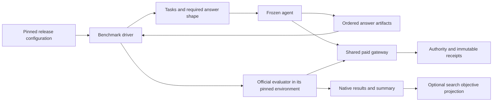

# Replaceable benchmark integration

October 20, 2026. BENCH-03A records the user's confirmed upgrade requirement: **install and pin a new official NoveltyBench release, configure it, check compatibility and funding, then run the existing agent before changing or optimizing that agent.** A benchmark update must not require rebuilding the agent, search controller or accounting system. [PLAN.md](PLAN.md) owns implementation order and status; this document defines the contract and acceptance criteria.

This is an accepted architecture requirement, not a claim that today's code already provides it. BENCH-02's official-conformance gate still applies. No paid route, allocation or historical result changes with this document.

## Three separate boundaries



| Boundary | Owns | Must not depend on |
| --- | --- | --- |
| Agent treatment | Generation instructions/code, model access, sampling/history, selection and inference limits. Consumes tasks and produces ordered answers. | A NoveltyBench release name, judge prompt, metric formula, native artifact directory or judge SDK. |
| Benchmark driver | Task loading, required answer count/shape, official evaluator invocation, its pinned dependencies/configuration, native parsing/retries/fallbacks, artifacts and summary. | Agent policy/source internals or permission to alter spending authority. |
| Shared host and paid gateway | Trusted execution, component verification, generic request/receipt capabilities, credentials, physical-attempt identity, reservation/accounting and replay. | Partition/Score stage names, ten answers, patience 0.8, v1.1 paths or a particular benchmark's score schema. |

The reusable driver/runner invokes the installed pinned official implementation. Compatible releases use the same driver/runner code with different release data and official environments; handwritten adapters per ordinary release do not satisfy this contract. The gateway bridge accounts for actual physical provider attempts without rewriting prompts, adding request parameters, substituting local parsing or dropping official failures. Source-backed differential checks establish that the bridge preserves official behavior. A small allowlisted runner selection is sufficient; no plugin marketplace or new service is required. A necessary capability extension must be explicit and validated before claiming that a previously incompatible interface is supported.

## Release configuration and evidence

One immutable release bundle identifies:

- The benchmark family, release identifier, exact upstream source revision and source inventory. A metric version alone does not identify a changing repository.
- The driver contract/implementation and generic runner entry point, exact dependency lock/environment, and required runtime/platform capabilities.
- Dataset/task schema and hashes, required input/output modality and answer count, official configuration, native artifact inventory and summary entry point.
- Supported paid API capabilities and separately verified model/rate/usage bounds. Release data cannot grant paid authority, choose arbitrary network destinations or declare its own prices trustworthy.
- An optional, explicitly versioned projection from native measurements to the optimizer's objectives. This is separate from producing the official baseline result.

Configuration is data interpreted by reviewed code: declared entry points, argument lists, supported field/path mappings and capability identifiers. It is not arbitrary shell text, Python expressions or downloaded code executed on installation. Resolve mutable aliases such as `latest` once during preparation; a running or resumed experiment always uses its saved immutable selection.

The first NoveltyBench driver covers the existing official text-task/ordered-text-answer interface. Ordinary changes to prompts, datasets, judge models/settings, answer count, artifact names or supported CLI arguments belong in the release bundle. They must not cause edits across agent, search and accounting modules. Native algorithms, prompts, parsing, fallback and summary behavior come from the installed official evaluator, rather than a host copy with a growing set of version branches.

Configuration-only upgrades have a declared compatibility envelope. A future evaluator may introduce images, interactive environments, a new paid endpoint, an incompatible SDK protocol or an entirely different input interface. No implementation can execute unknown interfaces correctly by assumption. Such a change produces a precise compatibility report and an isolated capability/driver extension; it must not spread version checks throughout the host. This exceptional extension is distinct from tuning an agent because its baseline scored poorly.

## First run on a new release

Preparation pins the new evaluator independently of the existing agent. It checks source/lock integrity, supported task/output and provider capabilities, native fixture execution, receipt replay, model availability, verified liability bounds and the concrete allocation. These checks use canned or declared development fixtures; they must not inspect sealed final tasks or optimize against new benchmark scores.

The baseline freezes the existing agent source/policy, generation model and generation settings. Version-driven task requirements, such as the requested number of answers, are explicit task inputs; the agent must already support them through its interface. Changing a prompt template, sampling/history, generation model, limit, selector or instruction is a new treatment, even if someone calls the change compatibility work. Evaluation-side model changes prescribed by the new release belong to the new evaluator identity.

Then run that agent against the new release, retaining all answers, failures, physical receipts and official artifacts. Poor quality, repetition, refusal, malformed task-requested JSON, wrong sentence/count constraints and low scores are baseline outcomes; they are not compatibility failures to filter out. Preflight validates the outer interface, such as whether the agent can return an ordered text list and accept the required count. Unsupported modalities or an unreadable outer artifact are incompatibilities. It must not parse answer content to reject a story or structured task answer before official assessment, silently rewrite it or hide it from the recorded baseline.

The official baseline must be runnable before the search controller understands a changed metric. Save the native results and official summary first. If the new metric has no compatible objective projection, disable optimization and comparative ranking, explain what needs to be mapped, and preserve the baseline. Do not rename an unrelated metric utility/distinctiveness, recompute a convenient replacement score or require an optimization feature before basic evaluation works.

Only subsequent, separately identified treatments may use these development results to improve the agent or its improvement procedure. The official instrument remains fixed within each experiment. Evolvable agent orchestration is allowed; changes to the trusted driver/host bridge require conformance and authority checks and cannot become an unrecorded way to improve scores. Final/held-out results remain outside improvement feedback.

## Retirement without losing history

Retiring a release removes it from active/default selection and prevents new paid run creation. It does not erase results, source bundles, dependency locks, receipts, ledger schemas, unresolved holds or provenance. Keep bounded, read-only historical readers separately from active evaluator execution; preserving evidence does not require importing or installing an old judge SDK.

Existing runs never follow a new default. Before uninstalling their driver, either retain their exact bounded runtime for authorized completion or close their allocations. An unknown operation retains its liability. A replacement call or linked continuation keeps its separate identity. Offline replay of saved receipts is distinct from fresh regeneration, which may become unavailable if an old model is retired.

For new manifests, bind the shared host core, selected driver/source/lock, agent treatment, official configuration, population and paid capability profile separately and together. Include transitive runtime dependencies and nested package files. An unrelated driver installed in its own environment must not change a frozen run's identity; changes to shared code actually used by that run must. Do not solve this by omitting plugin files from source verification.

Legacy manifests retain their existing identity algorithm and sealed runtime. No rehashing, relabeling, blanket source-guard exception or evidence migration is implied. Historical readers must preserve both legal earlier uncertainty receipts and terminal receipts; REC-05A's known limitation remains open.

## Current coupling to remove

These are inspected repository facts, rather than hypothetical future failures:

| Evidence | Consequence for the new boundary |
| --- | --- |
| `run.RunSettings`, `run.evaluate_prompts`, `evaluation.EvaluationProtocol` | Generation and v1.1 judge models/limits/count/formula are combined. Extract the frozen agent/answer-artifact seam; keep v1.1-specific settings with its driver. |
| `reference.py` imports `benchmark.py` and `run._schema` | The request foundation is v1.1-specific. Keep it behind that driver; do not promote it to the shared provider contract. |
| `search.py`, benchmark import/export and CLI/progress | Search assumes v1.1 metrics and artifact paths. Native baseline collection must stand alone; objective projection and promotion/completeness policy remain separate. |
| `authorization.py`, `history.py`, `diagnostics.py`, `policy.py`, `splits.py` imports | Generic JSON/validation or task helpers currently come through scientific modules. Reuse those implementations from a version-neutral boundary as needed; avoid keeping old evaluator code solely to read money records. |
| `authorization.runtime_fingerprint()` | It hashes all top-level package Python files. New manifests need explicit selected-component and dependency inventories; nested drivers must be covered and unrelated installations must not invalidate replay. Preserve the legacy guard. |

The uncommitted BENCH-02B native-call draft was preserved separately before this contract slice. Its stage/model-specific construction must move behind the driver rather than establish a universal host API. No draft paid dispatch is enabled.

## Acceptance criteria

| ID | Required evidence |
| --- | --- |
| MOD-1 | The same frozen agent runs against current and second canned release configurations with different answer counts, dataset fields and artifact paths. Agent, generic driver/runner, controller, accounting and gateway source hashes are unchanged; only release configuration and the pinned official implementation/environment change. No per-release handwritten adapter or version-specific host import is permitted. The second fixture is a compatibility test, not a claim about a real future NoveltyBench release. |
| MOD-2 | The second release changes its official evaluator behavior through its pinned implementation/environment; native results match direct official execution under the same configuration. Bridge checks cover malformed/refused/truncated output, retries, fallback and summaries. A copied host scoring formula is insufficient evidence. |
| MOD-3 | Source/lock/configuration/selected-driver/capability changes alter experiment identity. Installing or retiring an unselected isolated driver leaves it unchanged. A changed nested or transitive selected file is rejected before execution. |
| MOD-4 | Unsupported outer task/output/paid capabilities, invalid mappings, unsafe paths, configuration drift and insufficient authority fail before credentials or sends. Weak, malformed or noncompliant answer text remains recorded and reaches official assessment; task-format validation cannot become an unrecorded baseline filter. |
| MOD-5 | The first new-release run records the unchanged agent treatment and preserves native artifacts even without an optimizer projection. Optimization remains disabled until the mapping is explicitly defined and validated. |
| MOD-6 | Every native physical attempt passes through shared authority, including retries and fallbacks. Direct credential/network bypass is denied; unknown liability stops further dispatch. Cached receipt replay sends nothing. |
| MOD-7 | Retiring/removing the old active driver leaves old artifact seals, read-only verification, known costs and unknown holds unchanged, requires no old evaluator dependency for accounting, and cannot reopen paid authority. |

BENCH-03 is complete only when these composed checks pass. A descriptor class, registry, import-only test or configuration file by itself does not establish plug-and-play upgrades. BENCH-02 independently requires exact official conformance; source self-modification and improved useful diversity retain their own gates.

## BENCH-03B: implemented offline configuration and identity boundary

`buddha.releases` is independent of the old benchmark, evaluator, controller and accounting imports. It uses only the standard library and exposes:

| API | Function and limits |
| --- | --- |
| `Release.from_record()` / `Release.from_bytes()` | Validate and freeze release data: upstream revision, complete expected official-file inventory, lock/dataset paths, literal JSON field mappings, answer count, sealed Python module entry points with argument lists, output paths and required capability identifiers. No import, installation or evaluation occurs. |
| `inventory(root)` | Hash every regular file in a selected directory, including nested dependencies. Reject unsafe/aliased portable paths, links, reparse points, hard-link aliases, special files, unreadable subtrees, observed concurrent changes and bounded-resource violations. No filenames or cache directories are silently excluded. |
| `prepare_selection(release, roots, capabilities=...)` | Check required capabilities before reading components, verify the real official tree against its expected inventory, and snapshot five disjoint roots: official source, dependency environment, reusable runner, host, and agent. Host-supplied capability identifiers select real profile files under the host root; release data cannot manufacture a capability or paid permission. |
| `Selection.to_bytes()` / `Selection.from_bytes()` | Preserve a deeply immutable, canonical record with separate release and agent fingerprints and component inventories. Returned dictionaries are independent copies. Installation paths are excluded from identity; relative names and file bytes are included. |
| `verify_selection(selection, roots, expected_sha256=...)` | Compare the selection to the owning manifest's frozen expected digest before reading files, then recheck every selected tree. A consistently edited record cannot pass against the original expected identity. No writes, locks, credential access, subprocesses or network calls occur. |

Version 1 supports literal top-level JSON field mappings, 1–1,000 ordered text answers, at most 32 module invocations with 128 arguments each, and the whole-argument `{artifacts}` placeholder. Module names must identify files in the sealed official source. Arguments are data for the future runner, never shell text or expressions. A new argument schema outside this envelope must fail explicitly; it must not be evaluated as code. Portable path validation includes Windows reserved names and case/ancestor collisions.

The implementation bounds each JSON record at 32 MiB, each component at 100,000 entries / 64 GiB, and each file at 8 GiB, hashing in bounded chunks. These are host integrity-check ceilings, not an API token or research budget. File-handle identity, size and modification time are checked against path metadata; full before/after path checks retain creation/change time. Python 3.13 on Windows can return a different `ctime` through `fstat` and `lstat`, so those two sources' `ctime` values are not equated. Directory changes and traversal errors remain explicit failures.

This selection checks the actual files inside the roots provided by the host. It does **not** discover imports outside them, certify dependency-lock/install equivalence, execute CLI compatibility checks, prove upstream authenticity or bind an allocation. The runner must validate its environment/import confinement and consume this selection under its immutable owning run before any live claim. The existing manifest/runtime algorithm remains unchanged. Unrelated releases must live outside the selected roots; putting all releases under one selected component would correctly include them in that component's identity.

The second canned release test proves configuration acceptance and stable agent/runner inventories with changed counts/field names/artifact paths. It does not run the second evaluator or establish the composed MOD-1–7 gates, which remain BENCH-03C. Weak or malformed answer content is never inspected by this integrity layer.

The focused check below runs once in the existing PowerShell window. It creates and removes temporary fixture directories, reads their files, and spends nothing. It needs no API keys or downloaded evaluator environment:

```powershell
python -m unittest discover -s tests -p test_releases.py
```

It tests configuration validation, immutable round trips, real selected-file drift, nested dependencies, unrelated installation/removal, frozen owner identity, portable path/link/resource boundaries and offline behavior. The old runtime and paid-call tests remain part of the full regression suite. No new user-facing release execution command is enabled by this slice.

[Delivery evidence](conformance/nb03b-delivery.json) records the successful 418-test full suite in 92.312 seconds (two host symlink-privilege skips), 26 focused checks (one host skip), Ruff lint/format, strict mypy across 18 runtime modules, Bandit, application dependency audit, compilation and whitespace checks. All 287 protected historical input hashes remain unchanged. Independent review's Windows reserved-name finding was reproduced with 13 failing assertions and closed using the standard-library predicate plus directory-case checks. BENCH-03A's hosted Windows/Linux checks passed; this slice's hosted results are reported separately after publication.

## BENCH-02B: funded request and raw-evidence boundary

`buddha.gateway` implements an actual request path through the existing attached-database shared authority. It does not run or interpret NoveltyBench. Its new `buddha.gateway-run.v1` manifest selects the release, five component roots, host-owned capability profiles, ordered invocation input files, actual installed host source and runtime. The existing baseline/search/continuation manifest formats keep their old identity and request algorithms. No financial schema or historical artifact is migrated by this slice.

| API | Function and limits |
| --- | --- |
| `prepare_gateway(...)` | Verify and freeze the selection, profiles, actual host code/runtime and ordered input hashes; create an empty run and bind it to a supplied real authorization. It reads no API key and contacts no provider. It never overwrites a directory. Creating a profile does not grant spending authority. |
| `execution_identity(...)` | Compare the actual selected files, profile bytes, input files, runtime and installed host modules with the owning manifest. It returns the frozen identity; it cannot accept freshly changed code as the old identity. |
| `GatewayCall(...)` | Freeze exact JSON body bytes, capability, selected profile, trusted logical call identity and physical attempt number. The gateway adds no body cap, tier, prompt or judgment schema. |
| `Gateway.execute(...)` | Check the frozen owner and request, use the real shared allocation, reserve the applicable maximum, prepare credentials/connection, claim one dispatch, capture raw evidence and record billing. Each call sends at most once. Completed matching evidence replays without credentials, an active allocation or a paid transport. |
| `RawEnvelope` / `extract_usage(...)` | Preserve bounded immutable body bytes and selected response headers; extract billing counters independently of assistant-content parsing. A malformed assistant answer can still have known billable usage. Missing/ambiguous billing evidence retains uncertainty. |

The two supported paid capabilities are OpenAI Chat Completions and Anthropic Messages over fixed HTTPS endpoints. They fund text only, one non-streamed completion, and explicitly supported text/cache fields. Unsupported tools, media, streaming, multiple completions, providers and tiers fail before credentials or sends. Capability extensions remain explicit host changes, separate from ordinary benchmark release configuration. HTTP request bodies are sent byte-for-byte; header, SDK and evaluator parity belong to BENCH-02C's differential checks.

Capability profiles are separately selected host files with format `buddha.gateway-profiles.v1`. Each profile contains a `ModelSpec` (provider, request model, documented input/output maxima, conservative input/output rates and HTTPS bounds source), allowed response model IDs, request/response tiers and explicit permission for an omitted tier. The rates must bound every applicable account tier, cache operation and other supported billing feature. Omitted OpenAI output caps reserve the configured documented model maximum; an explicit cap may lower that reservation. Anthropic requires its native explicit output allowance. The gateway never estimates a smaller input bound from prompt length.

The owning manifest also saves the account-scope review date and SHA-256 credential fingerprints. A new dispatch requires a review no older than seven days and the reviewed key; the profile is an operator attestation, not automatic verification of an account or invoice. This slice supplies only synthetic test profiles, no newly verified live model/rate preset or allocation. Counted charges use the declared upper rates and inclusive provider usage counters; actual invoices may differ.

The atomic reservation happens before key access. A local credential or connection-preparation failure therefore leaves a **reserved, unsent** operation: no provider request occurred, and correcting the local issue can reuse that exact identity and reservation. Changing the body/profile under that identity conflicts. Dispatch is claimed atomically, so two callers cannot send it twice. An unknown or outstanding dispatched operation, exhausted shared budget/call cap or known reservation overrun stops further shared spending. Existing legacy runs and new gateway runs consume the same shared envelope.

Each physical identity includes the owning run, immutable invocation, trusted caller's logical identity and attempt number. Exact body/profile/selection hashes are independent consistency checks; identical bodies in different positions or attempts remain different requests. HTTP arrival order and body hashes alone cannot identify samples. An offline probe of the actual pinned upstream `asyncio.as_completed` path found six different row-start orders across twelve identical concurrency-one invocations. Score heads also use `asyncio.gather`, and SDK retries interleave. BENCH-02C must establish the native context bridge; this library does not claim that an unmodified official CLI already supplies those identities.

Received evidence is checkpointed into immutable uncertainty history before billing extraction, then completed when model, tier, request identity and inclusive counters are established. Known cost overruns record the true upper-rate charge before halting; a token-bound violation that does not exceed the monetary reservation retains the full unknown hold and stops spending. Cached overrun evidence remains a bound violation, not a successful replay. Saving received evidence is not blocked by a post-send source/input change; the next dispatch is blocked instead.

Raw bodies are bounded at 16 MiB. Preserved headers are `x-request-id`, `request-id`, `retry-after`, `retry-after-ms`, `x-should-retry` and `content-type`, with bounded values, order and duplicates retained. Partial bodies are marked truncated. Invalid/unavailable selected headers produce `headers_complete=false`, without falsely describing a complete body as truncated. Neither case is billable completion. Retry headers preserve SDK policy inputs; they do not recreate wall-clock dates, random backoff jitter or historical timing.

Known provider credentials are screened in requests and received evidence, including ASCII JSON escapes inside malformed outer JSON. A credential-bearing response is withheld: only a digest/flags remain, never body/header content. Withheld or incomplete evidence cannot be replayed as an ordinary exact reply. One-shot local interruptions after capture or during checkpoint/terminal writes preserve the receipt before propagating the interruption. Process death, persistent storage failure or repeated interrupts before a durable checkpoint can still leave only an unknown reservation; no automatic redispatch follows. Non-success HTTP status without authenticated billing evidence also retains the hold rather than assuming a free retry.

The installed host module closure is bound separately from the operator's host-profile directory. A benign copied tree cannot stand in for changed executing code. This covers the explicit actual application modules and rejects unbound package imports/dynamic loading; it is not OS sandboxing, complete standard-library attestation or proof that the selected official environment matches its lock. The host still reuses generic validation/accounting helpers from existing modules. Removing that legacy import coupling, enforcing the native subprocess/network boundary, running official parsing/retries/fallbacks, and proving same-runner upgrades/retirement remain BENCH-02C/03C gates.

These checks run once in the current PowerShell window, create/remove temporary fixtures, use fake keys and mocked HTTP, and spend nothing. They need no downloaded official evaluator or real API keys:

```powershell
python -m unittest discover -s tests -p test_gateway.py
python -m unittest discover -s tests -p test_wire.py
```

The first command checks the real shared-authority request/receipt path, including failures, races, interruptions and mixed legacy/new funding. The second checks immutable raw records, header and billing validation independently of benchmark semantics. No new user-facing paid command is enabled until the native runner is implemented and verified.

## BENCH-02C1: frozen answers and native call context

The artifact seam separates an agent's ordered text from the evaluator's rules. `buddha.answers.Task` contains only an ID, literal prompt and requested answer count. It has no judge prompt, metric version or scoring formula. `TaskSet.from_dataset()` / `.from_file()` check the exact configured dataset hash and freeze its source and release identity. String and signed 64-bit integer IDs remain distinct; booleans/floats are rejected. `TaskSet.select(ordered_ids)` binds a nonempty, explicit population and its order without pretending a copied subset is the original official dataset.

`Answers.from_results()` accepts the exact ordered population, an agent fingerprint and noncolliding host metadata. `.native_bytes()` exports JSONL using the selected release's field mappings. Original row fields, including distinct `prompt_paraphrases`, survive unchanged; they matter to the official cache key even where a judge does not read them. Outer count/type/order/UTF-8 errors fail, but empty text, refusal placeholders, duplicates, malformed task-requested JSON and noncompliant writing remain literal answers. No task-content quality filter, score, rank or optimizer projection is involved.

Both artifacts retain full dataset bytes for the trusted host to verify their derivation. **An agent receives only its selected individual `Task` objects, never the full `TaskSet` or `Answers` source-bearing record.** These classes do not execute agent code, generate answers, authorize a split/population or grant access to final data. The later controller must enforce those permissions and bind these immutable inputs to the actual worker and funding invocation. Returned records are copies; canonical bytes and their fingerprints are immutable.

`buddha.native_context.Contexts` supplies a separate identity primitive for a trusted native worker. `.row(identity)` enters an explicit population/cache context. `.wrap(async_function, label)` returns a synchronous coroutine factory: it allocates its child ordinal when the native code creates the coroutine, before `gather` schedules or awaits it. Nested wrappers distinguish logical judge calls and primary/fallback legs. `.attempt()` allocates a physical index inside that logical call, independent of body equality or HTTP arrival order. Counters are thread safe; context restoration covers exceptions and cancellation. Creating a wrapped coroutine outside a row or asking for an attempt outside a logical call fails.

Row exit restores the caller's context; it does not revoke snapshots already captured by pending coroutines or copied tasks. Context is identity data, not authority. The paid boundary must independently check the actual frozen command/cache key/typed row identity, invocation, worker role, source and allocation. It must terminate/reap owned work on cancellation. C1 does not install configurable hooks into complete official modules or prove their alias handling, subprocess lifetime or confinement.

`NativeStop` deliberately derives directly from `BaseException` and accepts only fixed sanitized reason codes. Both pinned SDKs retry ordinary transport `Exception` values. The future funded adapter must emit this stop only after the host has retained its ledger state, and the trusted outer runner must handle it as an incomplete run. It cannot let an unknown liability become another automatic SDK send. Native parse/fold/refusal errors keep their own original semantics; this stop does not redefine them.

The optional [selected-function probe](conformance/nb02c-context-probe.py) uses fixed-digest original NoveltyBench functions and the real pinned SDKs. It compares direct and instrumented results/request hashes, checks concurrent identical-body calls, cache resume, fallback/fold attempts and SDK retry escape. The artifact-backed fixture is explicitly synthetic; it is not a new official release. Retry sleep alone is stubbed. These are selected-function/SDK observations, not full CLI execution, a funded Gateway adapter, original timing, header/compression parity or an OS sandbox.

The regular checks below run once in the current PowerShell window, use temporary data and canned async functions, require no SDK downloads or keys, and spend nothing:

```powershell
python -m unittest discover -s tests -p test_answers.py
python -m unittest discover -s tests -p test_native_context.py
```

The first checks the frozen source/population/native-answer boundary across two release configurations; the second checks logical/physical identities under changed scheduling, cancellation and copied thread contexts.

The optional probe needs the already prepared [locked research environment](BENCHMARK-REFERENCE-PROFILE.md#reproduction-and-dependency-notices) and the six fixed-hash source/license files listed in its script. A clean checkout alone does not contain those ignored reference inputs. It runs once in the same window, uses fake keys and blocked network, writes temporary fixtures plus ignored evidence under `runs/reviews/`, and spends nothing. `Ctrl+C` stops it:

```powershell
.\runs\reference-env\Scripts\python.exe docs/conformance/nb02c-context-probe.py
```

C2 below delivers the funded SDK transport/header/compression seam and offline admission/replay composition. Remaining native integration includes a confined official environment and production worker channel, configured full-module hooks, actual module/CLI artifacts and summaries, and the frozen seed agent's generation path. Source evolution and the composed configuration-only upgrade/retirement gates remain separate. The preserved AnyIO lock advisories still require an explicit active-environment/confinement assessment; no research-only audit is presented as live readiness.

## BENCH-02C2: optional SDK views over the funded gateway

`buddha.native_transport.make_transport()` returns the selected SDK HTTP transport type: HTTPX for OpenAI, HTTPX2 for Anthropic. These packages remain optional isolated evaluator dependencies, not application dependencies. A host-supplied async `Exchange` accepts a frozen `NativeRequest` and returns durable `RawEnvelope` evidence. The adapter allocates the logical/physical identity before its first await, preserves exact SDK body bytes, and exposes no provider credential or direct HTTP transport.

The adapter validates the fixed POST endpoint, literal Host and Content-Length, then removes only SDK placeholder authentication, host/length framing and ordinary connection keep-alive. Cookie/proxy credentials and other hop headers fail. All remaining SDK headers reach host profile validation. Supported metadata, semantic and account headers are never silently discarded. Responses retain original encoded bytes and selected headers for the real SDK's parsing and decoding; the host separately validates bounded content decoding and billing.

Gateway profile format `buddha.gateway-profiles.v2` adds `headers` (supported lowercase names mapped to explicit nonempty lists of reviewed values) and `account_headers` (provider-specific owner account names mapped to one fixed value). Unsupported names, arbitrary-value declarations, control characters, duplicates and unreviewed values fail before credentials or reservation. SDK retry metadata must match the physical attempt index. Worker-supplied account copies must equal the frozen owner; omitted owner account headers are injected by the host. The complete profile, submitted headers and exact body remain bound to the invocation/request. Existing v1 profiles and empty-header call records retain their original representation.

Content coding is limited to identity, gzip and zlib/raw deflate, with at most five ordered layers and 16 MiB limits on encoded, intermediate and final bodies. Encoding headers, raw bytes and their digest remain immutable. Truncated streams, trailing compressed members, unsupported coding and excessive expansion stop with unknown liability. This is deliberately stricter than the pinned SDKs' lenient behavior on missing gzip trailers or trailing bytes: those cases are recorded authority/evidence stops, not exact native-parser equivalence.

Known provider credentials are screened in received raw bytes, selected headers and bounded decoded content, including ASCII JSON escapes. Opaque or unreadable final payloads are withheld. Without complete response headers, requested compression is withheld; otherwise only verifiable plain JSON is retained. These rules prevent the demonstrated compressed-key retention paths, including unsolicited or misdeclared compression. They do not claim exhaustive detection of arbitrary encodings embedded in ordinary answer text. Withholding retains the received digest and unknown hold, rather than recoverable body/header bytes.

`NativeStop` propagates without SDK retries; an unexpected exchange exception becomes a sanitized unknown stop. Native judgment/schema/fold/refusal parsing still runs in the original SDK/evaluator after a complete funded response. Cancellation remains cancellation: this adapter does not claim to terminate host work. The trusted channel and owned-process cleanup belong to C3.

The [funded SDK probe](conformance/nb02c2-funded-sdk-probe.py) composes real attached authority, the actual Gateway and mocked HTTPS with the pinned SDKs and original selected evaluator functions. It checks raw receipt replay through native parsing without keys or further sends, concurrent identical-body identities under one offline admission queue, malformed judgment text, refusal/fallback, fold attempts, compression, and durable unknown/authority stops. Synthetic profiles explicitly cover the observed Windows SDK metadata; they are not live pricing/account approvals. This remains selected-function evidence. The in-process offline queue does not establish a production worker channel, actual installed-lock closure, complete official CLI execution, OS confinement or worker credential exclusion.

These commands run once in the current PowerShell window, use temporary fixtures and synthetic credentials, and spend nothing. They need no SDK installation or real keys:

```powershell
python -m unittest discover -s tests -p test_gateway_headers.py
python -m unittest discover -s tests -p test_native_transport.py
python -m unittest discover -s tests -p test_wire.py
```

The first checks profile/account/header and compressed-receipt safeguards through actual accounting. The second checks the optional transport's exact-byte/context/stop boundaries with a canned SDK interface. The third checks bounded raw evidence and decoding independently.

The optional command below requires the already prepared locked research environment and fixed-hash reference files described for C1. It runs once in the same window, blocks external network, uses fake keys, writes temporary fixtures and ignored evidence under `runs/reviews/`, and spends nothing. `Ctrl+C` stops it. The preserved AnyIO advisories mean this research environment is not approved for a live worker:

```powershell
.\runs\reference-env\Scripts\python.exe docs/conformance/nb02c2-funded-sdk-probe.py
```

Complete official modules, generic configured hooks/aliases/resume, confined bounded channels, actual native artifacts/summary and unchanged frozen-agent generation remain BENCH-02C3. The same-agent/same-runner release upgrade and safe retirement proof remains BENCH-03C. No new paid CLI or allocation is enabled here.

[Delivery evidence](conformance/nb02c2-delivery.json) records the 555-test local suite and root-reproduced 30-scenario oracle. [The independent boundary review](conformance/nb02c2-boundary-review.md) records reproduced failures, closed regressions and remaining execution limits. All 287 protected historical inputs remain byte-identical.
