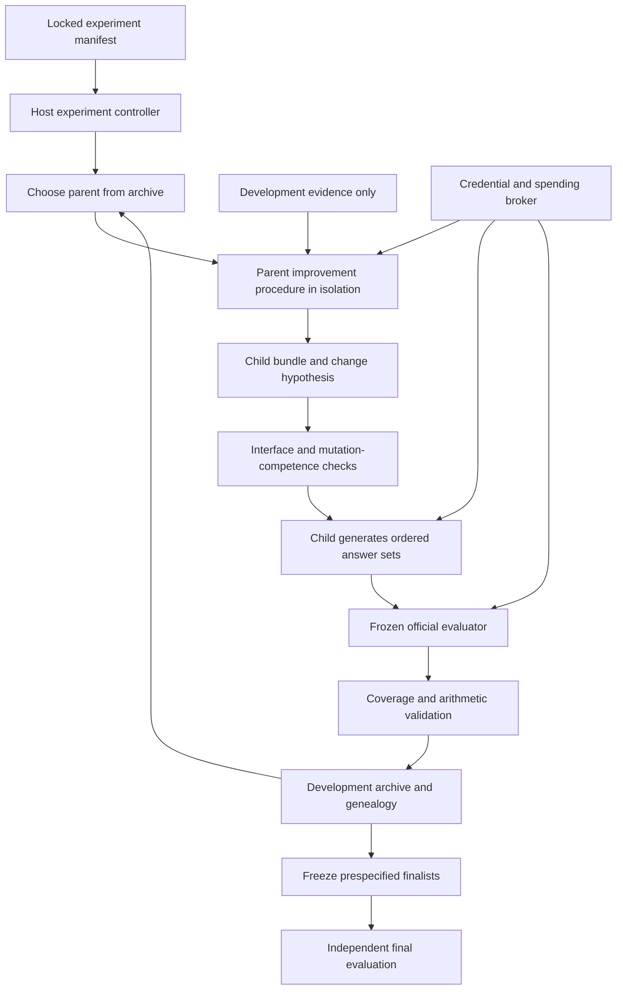

# Buddha: a self-improving agent for useful diversity

The [consolidated living plan](PLAN.md) owns current sequence, status, dependencies and the next slice. This document owns the architecture and scientific contract. Its original slice numbers below are retained for traceability, not as a competing roadmap.

The [replaceable benchmark contract](BENCHMARK-INTEGRATION.md) supplies the confirmed upgrade/retirement boundary: pin a new official evaluator through release configuration, run the existing frozen agent after compatibility/funding checks, then use development results for later self-improvement. Agent treatment, benchmark driver and shared paid gateway have separate identities and responsibilities. Release selection, the funded gateway, frozen answers and native SDK transport seams are implemented at their declared bounds. [Confined full-module LLM partitioning, scoring and summary](CONFINED-NATIVE-EVALUATION.md) now run through that boundary. [Isolated fixed-seed generation](FROZEN-SEED.md#isolated-fixed-seed-generation) now derives source-bound C1 Answers through host-owned accounting; [complete selected native baselines](NATIVE-BASELINE.md) now pass generated-data direct-oracle checks offline; configuration-only upgrades/retirement remain open; the historical v1.1-specific interfaces described below remain frozen evidence, not a universal integration API.

Design date: October 18, 2026; implementation status updated October 20. Slices 1–3 and bounded linked recovery are implemented; source evolution remains proposed. The interrupted first attempt now has a verified linked result reusing its nine replies, while the original missing request stays unknown and held. The fresh restart also completed its one-prompt pilot. Observed score differences do not establish meaningful diversity or general improvement. The latest official code and protocol checked for these experiments, v1.1, are normative; the paper supplies historical context. See [the incident review](FIRST-LIVE-REVIEW.md), [fresh-pilot results](FIRST-LIVE-RESULTS.md), [linked results](LINKED-CONTINUATION-RESULTS.md), and [pilot concerns](PILOT-REVIEW.md). No leaderboard submission has occurred.

## 1. Objective and claims

Build an agent that changes its own generation and improvement procedures to produce ten meaningfully different, useful answers to a prompt. Optimize the official NoveltyBench distinctiveness and utility metrics under a declared inference budget. The target is the inference-time systems category, not the raw-model category.

The design has three separately testable claims:

1. **Useful diversity:** a frozen agent improves held-out utility or distinctiveness without a material loss on the other axis.
2. **Source self-modification:** a parent agent authors a new implementation of its own task and/or improvement procedures, and that child runs successfully in isolation.
3. **Improved ability to improve:** an evolved improvement procedure produces better descendants than the initial procedure under the same starting conditions and total budget.

A rising maximum score in an archive establishes none of these by itself. The system should record failures and negative results as first-class outcomes. No claim of indefinite open-endedness, improved foundation-model weights, scientific originality, or general recursive intelligence follows from this experiment.

NoveltyBench defines functional diversity relative to the other answers for the same prompt. Its utility already incorporates first-occurrence novelty. Keep the two metrics separate; do not multiply them and count diversity twice. The original paper's metric and the newer upstream evaluator are different experimental protocols. See [the benchmark audit](NOVELTYBENCH.md) for pinned evidence and [the research handoff](RESEARCH.md) for method provenance.

## 2. What changes and what remains authoritative

The desired endpoint is source evolution. A cheaper, restricted policy optimizer is a baseline and an integration stage, not a substitute for source self-modification.

| Component | Mutable by a candidate? | Responsibility |
| --- | --- | --- |
| Agent bundle: generator, planner, critic, selector, improver | Yes, within its isolated bundle | Produce answers; author child bundles |
| JSON policy parameters | Yes, within host ceilings | Prompts, sampling, planning and selection choices |
| Local, development-only memory | Yes, scoped to lineage/run | Lessons and unsuccessful approaches |
| Base model weights | No | Fixed model APIs for this experiment |
| Official evaluator, prompts and judge configuration | No | Measurement comparable within one pinned protocol |
| Split manifests and final evaluation controller | No | Prevent optimization feedback from using final data |
| Provider broker, credentials, budget ledger | No | Authorize and account for every paid operation |
| Archive history and promotion criteria | No | Preserve evidence and decide eligibility |
| Sandbox limits and host filesystem | No | Bound execution and access |

This follows the useful separation in DGM between editable agents and fixed experiment orchestration. HyperAgents supplies conceptual motivation to separate the task procedure from its improvement procedure; its implementation is excluded. No HyperAgents code or implementation-specific prompts are incorporated.

## 3. End-to-end execution



All arrows that invoke a model pass through the broker. The controller, not generated code, decides the dataset, number of calls, score protocol, and final evaluation occasion.

The primary loop is:

1. Verify immutable manifest, source hashes, available funds, and sandbox readiness. Resume durable operations if this is an interrupted run.
2. Select a viable parent and an eligible development feedback packet. The packet includes task outcomes, duplicate patterns, compliance failures, costs, and an explicit change hypothesis; it excludes validation/final rows and judge instructions as editable targets.
3. Invoke the parent's `propose_improvement` entry point. It returns a child bundle and structured change explanation. Persist the proposal even if invalid.
4. Materialize only permitted regular UTF-8 files under a fresh child directory. Validate paths, file count and size, entry points, dependency allowlist, and content hashes. Reject traversal, absolute paths, links, special files, and attempts to replace host components.
5. Run mutation-competence and interface checks in the actual isolated executor. Compile/import success alone is insufficient.
6. Evaluate the child on a small, fixed development screen. Expand to a larger common development set only under a prespecified allocation rule. Record all evaluated IDs and seeds; compare candidates on common evidence.
7. Validate complete coverage and compute the official metrics. Archive viable candidates and failures; update the bounded parent pool. Do not overwrite previous measurements.
8. Stop when the call, token, dollar, iteration, or wall-clock limit is reached. A stop leaves a resumable terminal record and does not trigger a new run automatically.
9. At the experiment's declared finalization occasion, freeze finalists and evaluate without feeding results back into evolution.

## 4. Agent interface and search space

Conceptual interface, to be implemented in the source-evolution slice:

```python
generate(task, gateway) -> ordered_list_of_answers
propose_improvement(parent_bundle, development_feedback, gateway) -> child_bundle
```

`task` contains the current prompt, required answer count, and allowed resources. Each answer is a complete independent response to the original prompt. Private plans, candidate lists, probabilities, rationales for selection, and critiques are not automatically appended to answers. An answer to a request for one digit should be one digit.

The gateway exposes bounded, typed model requests and development-only artifact retrieval. It cannot expose raw credentials, arbitrary URLs, arbitrary subprocesses, final data, judge internals as mutable resources, or host storage. Tool and output schemas are validated on both sides. Candidate text remains untrusted data when inserted into judging prompts.

Seed procedures should be few and deliberately different:

- Independent sampling of ten answers.
- In-context regeneration: generate each next answer with previous answers visible.
- Plan central content first, then realize ten different plans independently.
- Verbalized-sampling candidate generation followed by a fixed, budgeted selection stage.

These are experimental seeds, not claims of novelty. Vary substantive answers or mechanisms rather than names, formatting, verbosity, or personas alone. Factual/randomness prompts often need direct short answers; they should not inherit a creative-writing scaffold indiscriminately. A model-based router is a mutable hypothesis with its own cost and failure rate, not mandatory initial machinery.

Initially evolve a validated JSON policy over those procedures with a fixed proposer. This is a baseline called **policy optimization**. Subsequently allow the inherited agent to change Python implementations of both entry points. This is **source self-modification**. Only the separate improver experiment can support the third claim in section 1.

## 5. Measurement contract

For one prompt, ordered answer classes `c[0:k]`, quality scores `q[0:k]`, and patience `p`:

\[
D = |\{c_i\}|,\qquad
U = \frac{\sum_{i=0}^{k-1} p^i q_i\,\mathbf{1}[c_i\notin\{c_j:j<i\}]}{\sum_{i=0}^{k-1}p^i}.
\]

Use `k=10, p=0.8` for the official protocol. The denominator form handles `p=1`; `p=0` evaluates the first response. Later members of a class receive zero utility even if better than the first member. Class labels have no intrinsic meaning. The evaluator's partition is an external measurement; string inequality is not a replacement.

The immutable `EvaluationProtocol` identifies:

- Exact upstream Git commit and metric version.
- Dataset and split content hashes.
- Explicit partition and quality model identifiers.
- Hashes of both effective judge prompts.
- Generation-configuration hash, including base model, prompt/template version, limits, decoding, reasoning allowance, selection procedure, and all applicable seeds.
- Fallback-policy hash, ordering seed, answer count, and patience.

Record resolved provider model identity and timestamp too when a vendor only offers a moving alias. Such calls are replayable from stored artifacts, but cannot be promised to regenerate identical tokens. Versions, seeds, prompts, and fingerprints support auditability; stochastic hosted models are not bit-identical reproducible engines.

Every evaluation record additionally binds candidate bundle hash, artifact hashes, prompt ID and content, ordered generations, partition, raw head-quality scores, provider request IDs, configuration, and terminal status. A changed judge, prompt, fallback, generation setting, candidate, ordering policy, or dataset requires a different evaluation key. A fallback changes the effective instrument and must be present in provenance and cache keys.

Full provenance equality is different from comparison compatibility. Each candidate's evidence must match its own declared fingerprint; two different generation policies should have different fingerprints. Cross-candidate comparisons require equal measurement instrument, population, base-model access, and resource ceilings while allowing the explicitly declared policy/source intervention. The future comparison manifest must encode those fixed controls separately from candidate-specific provenance. Never aggregate different candidate fingerprints into one run summary or require candidate code to be identical before comparing candidates.

The kernel implemented in slice 1 validates numeric metrics, manifest fingerprints, prompt identity, row uniqueness, reported arithmetic, and complete coverage. Its row fingerprint is a consistency field, not a signature or proof that a judge ran. The future importer must independently bind official file bytes and metadata to a run manifest; the kernel does not attest external origin or judge honesty.

Never silently drop failed evaluations. Preserve official complete-case summaries for external comparability, but produce a separate experiment status. Promotion requires complete expected coverage, evidence matching its declared protocol, compatible comparison controls, and no unresolved judge/provider failures. Generator refusal, judge refusal, malformed output, timeout, budget stop, and low-quality valid answer are different statuses. An empty generator response remains an attempted answer; it must not disappear from the denominator.

## 6. Archive and promotion

Optimize mean utility and mean distinctiveness separately, subject to validity, task compliance, and budget constraints. Store every proposal durably; keep only a bounded active parent pool. Start with a nondominated development frontier plus a small exploration reserve. A reserve can retain safe, different candidates that are temporarily worse. No unvalidated semantic embedding grid is needed for the first experiment.

Proposed pilot defaults, to freeze before a live run: at most 64 active parents, at least 10% parent probability reserved for exploration, and a 20% reserve of viable candidates outside the frontier. These are engineering starting values, not research-backed optima; tune them only on development evidence and version changes. Store the exact rule and RNG state in the manifest. Parent probability can combine rank, an exploration floor, and inverse descendant count, without calling the latter semantic novelty.

Archive admission is exploratory and is not a statistical improvement claim. Champion promotion uses a different rule on a fixed validation occasion:

\[
\operatorname{LCB}(\Delta U)>\delta_U,\quad
\operatorname{LCB}(\Delta D)\ge-\epsilon_D,
\]

or the prespecified symmetric rule for improving distinctiveness. Practical-effect margins, confidence method, familywise error budget, number of validation occasions, and finalist count must be fixed before observation. No numeric effect thresholds are chosen here without a variance pilot and a live budget.

A workable conservative policy is a fixed maximum number of validation occasions with alpha allocated in advance across occasions, finalists and both directional rules. Paired bootstrap intervals are an approximation and should be reported as such; avoid repeatedly peeking at ordinary 95% intervals. If the budget cannot support uncertainty estimates, report an exploratory ranking and no confirmed improvement.

Compare whole prompt-level answer sets as the experimental units. Ten answers to one prompt are correlated. Use repeated complete generation sets where affordable and prompt-cluster resampling with fixed seeds. Report subset results and uncertainty separately. Do not compare one candidate's easiest completed rows against another candidate's full dataset.

## 7. Data separation and valid comparisons

Freeze deduplication and near-duplicate prompt families before assigning development, validation, and final partitions. Stratify by source and broad task type. Use a deterministic assignment and store exact IDs/content hashes. Because related prompts travel together, exact split sizes may differ from target proportions.

A proposed initial allocation is 60% development, 20% validation, 20% final, separately within each benchmark source. This is approximately 60/20/20 Curated prompts and 600/200/200 WildChat prompts before family grouping. Exact membership is not created until the data preparation slice. Do not publish a supposedly frozen split with placeholder hashes.

Implemented slice 3 scope is narrower: one source per experiment, normalized exact-duplicate groups plus optional explicitly declared families, and deterministic approximately 60/20/20 allocation by group count. It does not implement semantic near-duplicate detection or task/source stratification. The common development screen takes the first sorted IDs from the frozen development split; it is an engineering screen, not a representative sample. Actual source hashes and every split ID are frozen. Validation/final evaluation and statistical promotion remain unimplemented.

The generator necessarily sees its current task during final inference. The improver, long-term memory, proposer, retrieval index, archive feedback, and human optimization decisions must not see final prompts/results through the experiment pipeline. Final evaluation is one-way: return a final report and stop the run.

The benchmark is public. Process separation cannot guarantee that base models have never seen its prompts. If optimizing on a subset, a later full 1,100-prompt score mixes development and held-out data and must disclose that fact. Use a separately authored, sealed transfer set to support generalization beyond NoveltyBench; do not call reworded benchmark items independent transfer.

Required comparisons, staged to respect budget:

| Question | Comparator |
| --- | --- |
| Does the scaffold help? | Same base model, independent sampling and in-context regeneration |
| Is complex search necessary? | Random policy search and reflective prompt optimization, such as GEPA |
| Does keeping stepping stones help? | Latest-only search under the same budget |
| Does evolving the improver help? | Fixed initial improver with the same archive and task-agent space |
| Does it transfer? | Frozen finalist on sealed prompts and an independent judgment audit |

Match inference budgets by model, total billed tokens including reasoning, total calls, candidate generation and selection, and declared output limits. Report search/proposer and judging costs separately, plus total research expenditure. Do not call an expensive scaffold superior to a ten-call raw model without disclosing the resource difference. Novamine's public scores are a contextual target; without its implementation and cost evidence, a matched-budget causal comparison is unresolved.

## 8. Measuring improvement competence

Interface smoke tests establish that the agent still generates answers and authors permitted changes. They do not establish that its improver is getting better.

For that claim, freeze initial and evolved improvers, select the same starting task-agent bundles and development feedback packets, and give each an equal total budget for `m` descendants. Use several starting bundles and seeds. Select descendants using the same development-only rule; assess them on a separate sealed task set. Compare improvement over each starting bundle, failure rates, costs, and regressions. Charge unsuccessful children and rejected proposals to the improver that made them.

Report separately: valid-child rate, change-target repair, held-out useful-diversity gain, and improvement per fixed budget. Source changes can improve generation while degrading mutation, or vice versa; retain this distinction. A null or negative improver result is publishable evidence and should not be relabeled recursive self-improvement.

## 9. Paid-operation integrity

The user authorized up to $50 for one first live experiment on October 19, 2026. The prepared search uses a single ledger across both seeds, proposals and child evaluation. Additional directories or comparator experiments are not additional spending authorization. Credentials remain user-supplied; research fetching and offline tests do not invoke model APIs. See [key management and accounting limits](API-KEYS.md).

Before a paid run, the manifest must contain currency, hard total cap, per-request token/reasoning limits, per-role allowances, verified provider price schedule/version, retry/fallback limits, and final-evaluation reserve. Refuse missing or invalid limits. Reserve a conservative maximum charge transactionally before dispatch; concurrent workers cannot spend the same balance. Retain reservation when external completion is uncertain. A client timeout is not proof that the provider did not process or bill a call.

Operation states: `planned -> reserved -> dispatched -> completed | failed | unknown`. Use a stable operation ID derived from run, candidate, stage, prompt, repetition, and attempt. Persist before dispatch and reconcile provider request IDs/usage before release or retry. Local deduplication prevents duplicate durable answers; it does not guarantee exactly-once external billing. Use provider idempotency support where documented. If no safe reconciliation exists, stop with `unknown` rather than automatically reissuing paid work.

A strict cap is only as strong as the provider's enforceable request limits and billing contract. Where a provider cannot offer a reliable maximum billable charge, use account/project spending controls or decline that provider for hard-cap execution. Never advertise a local token estimate as a guaranteed provider bill.

Use SQLite transactions and append-only run events for the first local implementation; no queue service, Redis, vector database, web service, or multi-tenant backend is required. SQLite records request lineage and reservations; model request payloads/artifacts live in scoped content-addressed files. Write files atomically and commit references only after durable materialization; recover orphaned files deterministically. A service version would require tenant identifiers and app-plus-database isolation from its first shared table, but this slice is a single-user library with no database or serving endpoints.

Read credentials only in the broker from the selected secret source. Do not print or persist raw keys. If key identity must be audited, use a keyed one-way fingerprint, with the fingerprinting secret outside artifacts. Redact credentials and personal data from structured logs; retain only necessary source text under user-controlled local storage.

## 10. Source-execution boundary

The host has a Docker Linux server available, observed as version 29.5.3. This is an availability check, not a validated sandbox. Arbitrary source execution remains disabled until integration checks prove the intended restrictions.

Use a disposable Linux container or stronger isolation with a pinned image digest, non-root user, read-only root filesystem and input mounts, bounded scratch space, dropped capabilities, no-new-privileges, process/memory/CPU/wall-clock limits, and no outbound network. Supply model access through an authenticated, narrowly scoped broker channel; never mount the Docker socket, home directory, repository credentials, API keys, or final artifacts. The child bundle is a data input to the executor, not an import into the host Python process.

The controller enforces timeouts by terminating the executor and all owned processes, not by waiting on an already-completed future. Test filesystem, secret, network, resource, and output-channel isolation using adversarial child bundles. Containers are a practical research boundary, not a proof of protection against host/kernel exploits. Stronger isolation can replace the executor without changing the scientific contract.

Working-directory restrictions, Python subprocesses, source allowlists, AST checks, and prompts are not security sandboxes. They can be defense-in-depth checks but cannot authorize host execution of generated code.

## 11. Failure modes and acceptance gates

| Failure mode | Required evidence/gate |
| --- | --- |
| Paraphrases counted as novelty | Functional-equivalence fixtures and blinded independent audit |
| Long rationales inflate diversity or utility | Strict task-form checks and binary/single-digit counterexamples |
| Judge order/model/prompt drift | Explicit protocol identity; order-sensitivity audit; no cache reuse |
| Missing/refused rows flatter the mean | Complete expected-ID and prompt-hash coverage before promotion |
| Search exploits official judge | Independent frozen audit instrument and human sample; disclose divergence |
| Validation becomes training | Limited validation occasions and separate finalization controller |
| “Better” only means more calls | Matched inference budget and total research-cost accounting |
| Source mutation destroys improver | Mutation competence suite plus controlled improver experiment |
| Retry duplicates paid work | Durable reservation, unknown state, reconciliation and fault injection |
| Candidate changes its examiner | Host-only evaluator, broker, splits and promotion components |

Acceptance for a credible result requires the claimed mode, full protocol, exact coverage, archived sources/outputs, budget/cost details, uncertainty, matched baselines, and limitations. Public leader superiority is not an acceptance requirement for infrastructure delivery; it is an empirical result that may or may not occur.

## 12. Original slices and consolidated-plan crosswalk

| Original slice | Concrete deliverable | Current-plan location |
| --- | --- | --- |
| 1 — research and evaluation foundation | Source audit, architecture, offline metric/coverage kernel and acceptance tests | Completed checkpoint; continuing reference requirements in PLAN |
| 2 — one auditable API evaluation | Frozen data/protocol manifest, provider broker/ledger, official-file importer/exporter, baseline generator | Completed bounded implementation; REC-01–05 address newly observed recovery gaps |
| 3 — bounded policy optimization | Fixed proposer, JSON policies, archive, common development screens, baselines | Completed engineering pilot; MEAS-01/02 and POL-01–03 govern further assessment/search |
| 4 — genuine source self-modification | Inherited task/improver bundle, isolated executor, lineage and mutation tests | SRC-01–03 retain the original source-evolution endpoint |
| 5 — scientific evaluation | Frozen finalists, independent final run, ablations and improver experiment | EVAL-01/02 and IMP-01 retain task and improver claims separately |

The original slice 3 live pilot is complete; [its results](FIRST-LIVE-RESULTS.md) establish the bounded engineering case, not a held-out improvement claim. New recovery and calibration gates were inserted without dropping original slices 4–5. Follow [PLAN.md](PLAN.md) for the current next item and its completion gate. The standing instruction in [AGENTS.md](../AGENTS.md) is to summarize, commit and open a separate PR for each slice, then continue authorized independent work until a live run or user decision is required. No background search, automatic spending, deployment, or leaderboard submission starts with this document.
