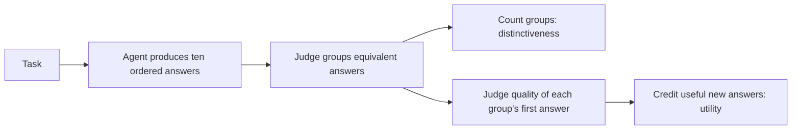

# How Buddha works: answers, judges, scores and improvement

This guide explains the experiment in ordinary language. It describes our pinned
NoveltyBench **v1.1** reference and the completed October 20, 2026 judge audit.
Future benchmark versions may change these rules. [PLAN.md](PLAN.md) remains the
roadmap; this guide explains the machinery and what its results mean.

## 1. What we are trying to build

We want an agent that gets better at giving a user several **useful, meaningfully
different answers** to the same request. For the standard NoveltyBench task,
that means ten answers. A creative story, a factual answer and a recommendation
have different requirements; the agent must still follow the actual request.

There are three roles. The **candidate agent** produces answers. The
**benchmark judges** assess them using the benchmark's fixed instructions. Our
**harness** is the coordinating software: it selects tasks, runs the candidate
and official evaluator, controls spending and saves evidence. The candidate is
not allowed to rewrite its examiner or its spending limits.

A normal evaluation follows this path:



The recent judge audit started with **already saved answers** at the grouping
step. It did not generate new stories or run the quality-scoring step.
It therefore needed only the configured OpenAI key. The earlier policy pilots
used OpenAI for generation/grouping and Anthropic for quality. These are
separate jobs; separate jobs do not necessarily use different models.

## 2. How the agent produces ten answers

The candidate has instructions and a procedure for using a fixed API model.
Our existing policy agents support two procedures:

- **Independent sampling (`regenerate`):** each answer request starts without
  the other answers in its conversation. The model can repeat a good-looking
  idea because it has not been shown its previous attempts.
- **In-context sampling:** later answer requests include earlier effective
  answers and a request to continue with something different. This gives the
  model information it can use to avoid repetition; it does not guarantee it.

Changing these instructions or procedures changes the candidate. Changing the
judge's instructions changes the measuring instrument. We record those changes
separately so that an apparent improvement cannot quietly come from an easier
examiner or more model access.

The ten answers have a saved **original generation order**. We retain poor,
empty or refused attempts according to the declared protocol rather than
quietly removing failures and scoring only the successes.

## 3. What counts as a distinct answer

NoveltyBench uses an AI judge to assess whether answers give substantially
different central content. Rewording the same plot, argument or recommendation
does not necessarily add another useful option. Different central content can
remain distinct despite a shared style or subject.

For “a story about a girl and her dog,” both characters are required. Their
presence in every answer is not itself a defect. Two stories might nevertheless
repeat the same discovery, problem, intervention and ending. The judge must
assess that central content, not just count different names or words.

The judge puts answers into **equivalence groups**. “Partition” is the technical
name for this grouping: every answer belongs to exactly one group. Ten answers
can produce anywhere from one group, if all are equivalent, to ten groups, if
each adds distinct central content. Group numbers are labels, not quality marks.

This is the benchmark's operational measure of distinctiveness. It is not a
measurement of how unprecedented an idea is across all human writing, nor a
guarantee that a human reader will agree with every grouping.

## 4. What our actual 4/5/9 result means

We took **the same ten saved stories** from recovery pilot A and asked the
official grouping judge to assess them on four fresh occasions:

| Occasion | What changed | Distinct groups assigned |
| --- | --- | ---: |
| Baseline | First audit judgment | 4 |
| Fresh repeat | Same scientific request, including display order | 5 |
| Shuffled display, seed 0 | Order in which the judge saw the stories | 9 |
| Shuffled display, seed 20261020 | Another order shown to the judge | 9 |

Thus “4/5/9 variation” means **4, 5, 9 and 9 groups out of ten stories**. It does
not mean four, five or nine new stories were generated, or that the agent
improved during these four judgments. The answers did not change. The fresh
judge responses grouped them differently.

With four groups, several stories share groups. With nine groups, just one
pair shares a group and the other eight stories stand separately. The model's
decisions about equivalence therefore materially change the distinctiveness
measurement for these fixed answers.

Only this one of the six historical full sets changed its pair relationships
across these four occasions. That is an observation about this small audit,
not a claim that every score is unstable. The independent model review had
already left this particular full set uncertain. We do not know a settled
“true number of groups” for it.

The same-order repeat also changed, so order alone cannot explain everything.
We have not isolated the provider-side cause of differing fresh responses.
The observed range 4–9 is not a statistical confidence interval.

There are **two different orders** to keep straight. A display shuffle changes
what the grouping judge sees. The official software then maps the decision back
to original generation order. Utility uses that original order. A display
shuffle does not by itself change which answer comes first for scoring; it can
affect scoring if the judge changes group membership.

## 5. Distinctiveness, quality and utility are different quantities

**Distinctiveness** is simply the number of groups for one task. Four groups
means a distinctiveness value of 4 for that answer set. A benchmark-wide mean
averages over its declared task population; our small control audit is not a
full benchmark score.

**Quality** asks how well an answer serves the request. In the executable v1.1
LLM scoring path we inspected, the judge rates the **first answer in each
group**, individually, on a 1–10 scale. The other answers in that group are not
separately quality-judged by this path. Wrong form, factual mistakes, poor craft
or failure to answer can lower quality even when an answer is distinct.

**Utility** combines quality, repetition and answer order:

1. Credit the first answer in each group with its quality rating.
2. Credit later members of an already encountered group with zero.
3. Give earlier positions more weight. With the default “patience” of 0.8,
   the weights begin `1, 0.8, 0.64, 0.512, ...`.
4. Average across **all ten weighted positions**, including the zero-credit
   duplicates. Do not average only the successful group representatives.

The first answer represents its group even if a later duplicate would be better
written. “First” does not mean “best.” A quality rating is 1–10; combined utility
can fall below 1 because duplicate positions contribute zero.

Here is a **hypothetical example**, not a rescoring of our stories. Assume every
group's first answer receives quality 8:

| Arrangement of ten answers | Distinctiveness | Utility |
| --- | ---: | ---: |
| All ten are different | 10 | 8.00 |
| Two groups first appear at answers 1 and 2 | 2 | 3.23 |
| Two groups first appear at answers 1 and 10 | 2 | 2.03 |
| All ten are equivalent | 1 | 1.79 |

For example, the second row credits only positions 1 and 2. Its weighted credit
is `8 × 1 + 8 × 0.8 = 14.4`. All ten weights still add to `4.463129088`, so
utility is `14.4 / 4.463129088`, or about `3.23`.

Equal distinctiveness need not mean equal utility. New useful content arriving
earlier receives more credit. Different quality ratings also change utility.

Consequently, the actual 4/5/9 grouping variation directly affects
**distinctiveness** and could affect **utility** by changing which answers earn
credit and which require quality judgments. Our audit ran no quality scoring,
so it provides no corresponding new utility values. We cannot infer those
values from the group counts or replace the old candidate rankings.

## 6. What a parser does

The judge returns data in a format software can read. A simplified response for
four answers might look like this:

```json
{"groups": [[0, 2], [1, 3]]}
```

The computer numbers displayed answers from zero. This says that the first and
third displayed answers belong together, and the second and fourth belong
together. The **parser** reads that text into a structured object. The official
**fold** then checks coverage, restores original order and produces the final
group labels and group count.

These checks answer “Can we interpret the grouping, and does it account for
every answer exactly once?” They cannot answer “Was the judge right about the
stories' meanings?” A perfectly formatted decision can still be debatable.

We sometimes used “parser recovery” as shorthand for this broader output
handling. More precisely, the relevant mechanism is **the official fold's
last-resort repair of incomplete or repeated index assignments**. It is not a
new semantic assessment by another reader.

## 7. How recovery can affect a score

Suppose ten answers are numbered 0–9. The judge returns readable JSON containing
just one group, but lists only answers 0–7:

```json
{"groups": [[0, 1, 2, 3, 4, 5, 6, 7]]}
```

Answers 8 and 9 are missing. The strict fold rejects this as an incomplete
partition. In the official partition-stage path, a fold-validation failure can
trigger another fresh judge call, up to three rounds. If every round's parsed
grouping still fails that check, the final fold uses a lenient rule on the
**last** parsed grouping:

- An omitted answer gets its own group.
- A repeated answer keeps its first group assignment.
- An out-of-range answer number is discarded.

In our example, the saved grouping becomes the eight listed answers together,
plus a separate group for answer 8 and another for answer 9: **three groups**.
The software has not compared the meanings of those two missing answers. They
might add new content, or they might repeat the first group. The final count
therefore contains default bookkeeping decisions as well as the judge's
explicit semantic decisions. Both distinctiveness and subsequent utility can
be affected.

This is a prescribed upstream recovery rule, not a private Buddha scoring
change. We retain the official output and identify the recovery separately.
We do not silently replace it with a preferred grouping.

Not every failure takes this route. Unreadable JSON, a schema error, a refusal,
a connection failure and a budget stop are different events. The three-round
loop specifically catches fold-validation failures; it is not a promise to
retry every error three times. SDK network retries are another layer. Our host
accounting can stop further requests when billing is uncertain rather than
repeat work that might already have been charged.

## 8. How we distinguish judgment variation from recovery

We save the reply received from the provider **before** its answer content is
interpreted. This preserves what the model actually returned, not just the
final group count. We also retain the exact request, displayed answer order,
model identity and the mapping to the original answers.

For the completed audit, the offline review:

1. Matched each of the 40 targets to its saved request and intact raw response.
2. Checked that every response explicitly assigned every answer exactly once.
3. Read the saved content through the pinned official schema and strict fold.
4. Confirmed that this reproduced every saved native partition.
5. Also tried the official lenient fold and confirmed it changed nothing.

All 40 passed. The four groupings for recovery A are already different in the
raw judge replies. Our parser did not invent that 4/5/9 difference, and missing
answers were not being filled in to create it.

If strict coverage had failed while lenient replay reproduced the saved result,
we would instead record the repair and the assignments it added or removed.
Earlier failed rounds and their costs would remain in the record. The number
of calls alone would not establish which path occurred.

This inspection proves a bounded software fact: the saved decisions were
interpreted faithfully. It does not prove that every semantic decision is
correct. The replay is offline and makes no new model calls.

## 9. What “less confidence in a single score” means

It means that one measured score may be a fragile basis for choosing a better
agent when a repeat can change substantially for the same answers. A candidate
could look better because a particular judging occasion separated more answers,
even if its generation procedure had not improved.

It does **not** mean the arithmetic is wrong, that we should discard the
benchmark, or that every result deserves the same doubt. We distinguish:

| Question | What we know here |
| --- | --- |
| Did the software preserve and interpret the replies correctly? | Yes, for all 40 inspected targets. |
| Did resolved development controls receive the expected decisions? | Yes, all 17 resolved baseline items, including equivalent controls. |
| Will every fresh judgment agree? | No such guarantee; one full set varied materially. |
| Do we know the right grouping for uncertain stories? | No; those independent judgments remain uncertain. |
| Has the agent shown reliable improvement on unseen tasks? | Not established by this audit. |

The five other full sets were stable across these four occasions, and the
explicit duplicate/paraphrase controls were merged. The judge was not simply
calling everything different. The lost-sounds bridge comparison stayed
distinct and matched its frozen independent model adjudication. Shared dogs
or lost sounds alone do not establish a scoring error.

Future comparisons must declare repeated answer sets, judge occasions and order
handling in advance, preserve unfavorable results and report uncertainty.
Selecting the most favorable of several partitions would bias the comparison.
Independent held-out assessment and the planned human sample remain necessary
for the broader scientific claims. The official benchmark still supplies the
official scores; a supplementary review does not replace its rule.

The earlier independent model review used separate instructed review contexts
with masked identities. That does not establish different model families or
statistical independence. Its resolved labels are useful development
expectations, with recorded limits, rather than human ground truth.

## 10. What the live run, costs and saved records mean

The audit contained **40 judging targets**, not 40 newly generated answer sets.
Its first batch covered 22 items: six full sets, nine focused comparisons and
seven authored controls. Three further batches each covered the same six full
sets. The authored controls and focused comparisons were judged once; they
were not each repeated four times.

Each target needed one physical API attempt in this run. All four batches have
verified completion anchors: records tying their saved inputs, native outputs
and accounting together. Recorded spending was **$0.032213**, with zero held.
These local amounts are not a reconciled provider invoice.

The earlier `$0.755400 held` messages were temporary conservative reservations
for an in-flight request, not charges of that amount. Before sending a request,
the broker sets aside its verified maximum charge. After a known completion,
it records usage-based cost and releases the unused reservation. If completion
is uncertain, it keeps the liability held and stops instead of assuming a
timeout was free.

Two kinds of repetition matter. **Replaying a saved receipt** resumes original
work without another provider call or charge. **Requesting a fresh judgment**
obtains a new response and is charged. Our six same-order repeats used fresh
requests with identical scientific bodies; they did not replay cached replies.
The older interrupted experiment's unresolved request and hold remain separate
from this completed audit.

## 11. Where self-improvement fits

Our existing search can propose changed instructions/sampling policies, evaluate
them and retain candidates in an archive. Retaining a candidate says it is
worth further investigation under that search rule. It does not establish
general improvement; comparing scores from different prompts, resources or
judging settings would be misleading.

The [bounded source-search loop](SOURCE-SEARCH.md) now connects changes to actual
agent Python code: choose a parent, run its improvement procedure, test its child,
and use measured results and checked failures in later proposals. A child can
later run its own changed improvement procedure. NoveltyBench 1.1 stays fixed.

Engineering rehearsals ran supplied Python programs in real isolation with
fake model replies. The [first actual source experiment](SOURCE-FIRST-LIVE-RESULTS.md)
separately produced three model-authored children, including a changed improvement
function used to author another child. The starter led every child on both mean
official metrics. That run used the historical short feedback; its evidence is
not upgraded by later full-output work.

For new witnessed searches, [bounded mutation checks](SOURCE-MUTATION-WITNESS.md)
require a parent to invoke its own improvement code with complete feedback to author
a changed further child, then run that child on the first development task.
Verified source copies and a supplied-program proof establish that bounded
engineering path. A current-version model demonstration and concrete capacity
evidence remain open. The separate experiment testing whether an evolved
improver produces better descendants is still planned. Neither changed code nor
a higher development score establishes that claim.

The [final-evaluation controller](FINAL-EVALUATION.md) handles a later stage:
freeze the declared finalists once, close adaptive work and run every final task
against the fixed comparison agents. Its final results stay outside the
improvement feedback. A completed comparison can still be negative or
inconclusive; the official evaluator and both native metrics remain unchanged.

The [completed policy comparison](POLICY-COMPARISON-RESULTS.md) now supplies the
registered scores and masked review. Seeing earlier answers produced larger
score gains, while some responses escaped literal constraints or repeated
broader plots. The next source-loop work must address those agent behaviors
under the fixed official evaluator. The [living plan](PLAN.md) retains the
remaining source, held-out and human gates. A live source experiment needs its
own reviewed handoff and allocation; unused balances do not authorize it.

## 12. What is frozen, and what an upgrade changes

An experiment records its candidate, answer texts/order, benchmark source
version, judge settings, data, limits and model identities. File **hashes** are
fingerprints used to detect changed bytes. A result belongs to those recorded
conditions; we cannot change them and pretend an old score measured the new
experiment. A fingerprint checks consistency, not whether a semantic judgment
is true.

The benchmark integration is separate from the agent and spending machinery.
For a compatible new benchmark release, the intended first step is to install
and pin it, configure/check its interface and run the existing frozen agent.
Later improvement uses those new development results. Compatibility checks can
refuse an unsupported interface; the harness must not quietly substitute an old
scoring rule. Historical results keep their own versions and evidence.

Saving the exact request and reply lets us replay an observation. It does not
promise that a fresh API call will produce identical text. In particular, a
provider model name may identify a changing service rather than permanently
fixed weights. Reproducible records and repeatable model behavior are different
promises.

## 13. Where to inspect the evidence and exact rules

- [Live audit results](MEASUREMENT-LIVE-RESULTS.md): the actual six-set table,
  controls, limitations and bound result record.
- [Independent model review](MEASUREMENT-AUDIT-RESULTS.md): what is resolved,
  what remains uncertain, and why that is not human ground truth.
- [Native pipeline](NATIVE-BASELINE.md) and [policy contract](POLICY-CONTRACT.md):
  generation, official execution and sampling details.
- [API keys and accounting](API-KEYS.md): key handling, budgets and recovery.

The normative source for this explanation is pinned upstream commit
`64a23be6b18ec1dacc298830aab276061b6e143c`:
[grouping and recovery](https://github.com/novelty-bench/novelty-bench/blob/64a23be6b18ec1dacc298830aab276061b6e143c/src/partition.py),
[quality and utility](https://github.com/novelty-bench/novelty-bench/blob/64a23be6b18ec1dacc298830aab276061b6e143c/src/score.py),
and [judge attempts and error handling](https://github.com/novelty-bench/novelty-bench/blob/64a23be6b18ec1dacc298830aab276061b6e143c/src/judge.py).
The executable head-selection/scoring functions control the explanation above;
the scoring file's introductory comment about scoring all generations does not
match this inspected LLM path.
