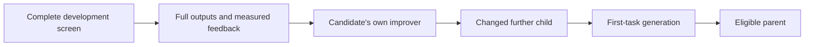

# Check that a parent can make a runnable further child

An agent can answer tasks successfully and still have a missing or broken
improvement function. A task score alone cannot tell Buddha whether that agent
can continue a source-evolution chain. New source searches therefore check both
abilities before selecting a parent.

This check uses the existing isolated Python executor, development evidence and
spending controls. It does not change NoveltyBench's evaluator, grouping rule,
distinctiveness score or utility score. [PLAN.md](PLAN.md) owns scheduling;
[SOURCE-SEARCH.md](SOURCE-SEARCH.md) describes the surrounding loop.

## What happens for each possible parent

1. Run its complete common development screen and retain the official results.
2. Give its own inherited improvement function every selected output **in full**,
   alongside that screen's measurements, using the verified
   [feedback bridge](SOURCE-FEEDBACK.md).
3. Ask it for a changed Python child through the existing protected proposal
   stage. The returned source must pass that stage's normal validation and
   materialization checks.
4. Run that further child's generation function on the first development task
   in the screen's fixed order, preserving the task's original ID and requested
   answer count. Require a complete, anchored generation result and clean
   execution cleanup.

The starting agent goes through this check too. A function may succeed without
calling a model. No callback minimum is imposed.

The further child is evidence that this one mutation worked. It does not enter
the search archive, receive a native benchmark score or replace a later search
proposal. It is not asked to make another child as part of this check. Ordinary
search iterations still prepare and record their own proposals and common
screens.

This is deliberately a narrow check. One successful further mutation does not
prove that an improver is effective, improves quality, works on other tasks or
will keep working indefinitely. The separate controlled improver comparison and
held-out evaluation remain necessary. Changed source can behave the same way;
this check does not require a semantic improvement. The further child's own
improver is not tested recursively here. If it later becomes an ordinary search
candidate, it must pass its own check before parent selection.

## What the outcomes mean

| Outcome | Record and consequence |
| --- | --- |
| Changed child materialized and first-task generation completes | A saved `passed` witness permits this candidate to enter the parent pool. Its common-screen scores remain the basis for parent selection. |
| Checked proposal rejection or checked generation failure | A saved `failed` witness excludes this candidate from the parent pool. Its literal source, common-screen outputs and official scores remain retained. |
| Interrupted request, unknown charge, missing completion or uncertain cleanup | The search is explicitly incomplete. It retains the original owner, any replies and financial holds. It cannot skip the work or create a replacement owner. |
| Starting agent has no eligible parent outcome | The search completes with reason `no_parent_eligible`, no ordinary iteration decisions and no selected parent. This is a complete negative result. |
| Later child fails the check | Its decision is `mutation_witness_failed`; previously eligible parents remain available. Its native measurements are not changed or converted into a penalty. |

Failure here means an observed failure under the recorded conditions. It is not
proof that the program can never improve anything. Uncertain execution cannot
be relabeled as a checked failure merely to let the loop continue.

## Original records, recovery and costs

The starting check lives in `seed-witness/`. Each later check lives in
`iterations/<index>/witness/`, beside its common screen. Each contains its own
plan, full feedback packet, proposal, optional generation stage and final
witness publication. These locations keep the common screen's original
financial census and feedback destination checks intact.

The plan binds the candidate's own screen, exact feedback bytes, first ordered
task and proposal recipe before execution. Later anchored proposal and generation
records bind the actual further child and original execution owners. Completion
requires the lower stages' independent completion anchors. Altering a JSON publication
and calculating a new hash cannot substitute for those anchors.

Recovery inspects every prepared witness owner, including work that has not
published a final report. A received reply is reused only through that original
owner; it is not billed again. An unknown request keeps its hold. A sealed stage
that only needs to publish local results does not request another paid attempt.

Witness model calls consume the same approved experiment allowance. Reports
show witness costs separately and include them once in the search's original
owner totals. The maximum owner count increases by two for each possible common
screen: one improvement owner and one generation owner. For a three-iteration,
three-task study with three native stages per task, the structural ceiling rises
from 51 to 59 owners. That is an owner count, not a request count, cost estimate
or promise that every maximum-size input fits.

Before another live handoff, verify the concrete full requests, model context,
output headroom, schedule capacity, processing terms and new allocation. This
implementation does not fund another run or reuse an older closed allowance.

## Verification and current limit

Forty-six focused test methods pass across separate recorded offline cohorts.
Seven quality checks also pass on the publication branch. The production code
and witness tests are byte-identical across that transfer; only the two newer
CI compatibility test repairs differ. This is not a full-suite or hosted-CI pass.

The actual Python-worker proof completes the missing-improver and raising-improver
negative controls. Its positive parent reads both full measured output rows and
produces a changed child, but that child's original mounted folder fails with an
input/output error before the worker is ready. The search correctly stays
incomplete. The original fixture and its pending owner remain unchanged.

A separate fresh-location control runs those same child bytes successfully with
the unchanged production worker and original configuration. This does not repair
the original owner or establish the cause of the mount failure. A fresh actual
composed positive witness still needs to pass before a live handoff. The native
stages in this proof are simulated and make no scoring-conformance claim.

The [delivery record](conformance/src02-mutation-witness-delivery.json) retains
the passing cohorts, original failed proof, bounded diagnostics and these limits.
No model calls, new allocation or operator run is required for this publication.

### Fresh startup checks

Two later, separately identified composed searches also stop before the further
child becomes ready: one uses a fresh folder in the original layout, and one uses
a shorter checkout and output path. Each observes ten real agent workers and
eighteen simulated native workers. Neither completes the required positive
witness. The shorter location does not resolve the failure.

Both new attempts use the same child, worker, runtime and canonical generation
input as the successful standalone control. Their receipts do not capture the
underlying startup exception. The earlier diagnostic's input/output error cannot
therefore be assigned to these attempts, and a Windows path-limit cause is not
established. All 236 pinned inputs in each producer checkout still match after
execution.

The [follow-up record](conformance/src02-startup-followup.json) keeps the exact
proof hashes, observed counts and limits. The failed owners remain incomplete
with their original evidence; no owner is replaced or retried.

A later [bounded diagnostic](conformance/src02-startup-localization.json) on
that retained short folder captures an input/output error at `/agent` during
source inventory, before runtime or candidate execution. Docker's before-start
and cleanup inspections both identify the intended read-only, non-recursive
source mount. The worker still cannot read it. The diagnostic uses two copied
trusted runner files with bounded exception reporting; removing that reporting
reproduces their original parsed statements. It performs one executor call,
removes its owned container and leaves the retained child and inputs unchanged.
This localizes the fault for that invocation; it does not identify a Docker or
filesystem cause or repair a source-search owner.

The trusted host created and fsynced the returned child after the parent
container finished. A separate [source-copy control](conformance/src02-startup-snapshot-control.json)
now uses that same 299-byte child at a fresh verified host location, keeping the
existing diagnostic runner, worker input and limits. It reaches readiness and
returns the expected `hello` and `goodbye`, with no stderr, model request or SQL.
Both sources and all 244 input pins remain unchanged, and the owned container is
removed. Restoring only the source path reproduces the prior configuration.
The raw Docker environment array has a different order; its 24 unique key/value
pairs match exactly.

This supports a prospective verified-copy route. One separately timed control
does not identify the filesystem cause, repair the original owner or complete a
source search. Next version that route before preparing fresh owners, preserve
historical source locations/reconstruction, and require a fresh composed proof.
No paid calls were made. The actual composed positive gate remains open.

## Verified source copies for new owners

New manifest v4 searches copy each materialized returned child's `candidate.py`
to a deterministic private directory beside its next screen or generation stage.
The host checks the original hash, byte limit, UTF-8 and exact file inventory,
then checks the copy and its selected components before preparing that owner.
The copy has the same code identity and lineage. Runtime, non-agent components,
resource limits, comparison controls and official scores keep their meanings.
Later improvement proposals use the checked source root from that child's screen.

This applies to returned children. The initial caller-supplied seed keeps its
reviewed root. The copy adds no model call or stage owner. A partial preparation
can reuse only exact bytes at the same planned location. Once its owner exists,
a missing or changed copy is refused; it is never recreated or remounted as a
recovery shortcut. The original returned source and proposal remain retained.

The standalone source-copy control above supports this route. Its actual
composed production proof is still pending; focused offline checks do not close
that gate or identify the Docker/filesystem cause.

## Versions and library settings

New `prepare_source_search(...)` calls default to `mutation_witness=True` and
`source_copy=None`, writing source-search manifest v4. The fixed witness policy is
`buddha.source-mutation-witness.v1`: one further mutation and generation on the
first ordered development task. New complete publications use search-report
v2 and bind this policy.

New live proposals use source-handoff v3, which requires the fixed witness and
`buddha.source-copy.v1` policies. The launcher derives both from the originally
reviewed proposal and verifies the prepared search before dispatch. A coherent
older search cannot satisfy a new approval requiring source copies.

`source_copy=False` with the witness enabled explicitly prepares historical
manifest v3. `source_copy=True` requires the witness and selects v4. `None`
follows the witnessed default; other types are refused. Historical handoffs v1/v2
explicitly select no copy, retaining their original preparation/replay policy.

Explicit `mutation_witness=False` retains full-output task-only manifest v2 for
reviewed compatibility callers. Historical manifest v1 retains its original
prefix-feedback meaning; manifest v2 retains its task-only meaning. Existing
handoff v1/v2 records and completed reports are not upgraded, resealed or assigned
new competence claims. These are Python library settings, not additional
PowerShell commands.

Full outputs remain subject to explicit packet and request capacity limits.
Buddha stops and records a partial result when complete required information
cannot fit. It does not shorten outputs to make this check pass.
